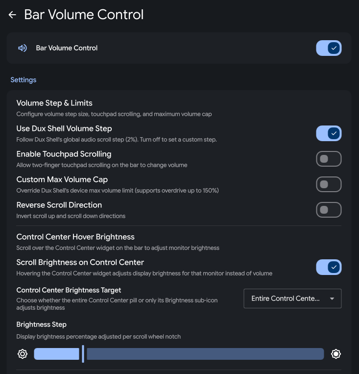

# Bar Volume Control

Control the system volume and monitor brightness by scrolling over any [Dux Shell](https://duxlabs.dev) bar (`dux-shell >= 2.0.0`).


## Note
This is the plugin I use daily, so it won't be abandoned. If you see long gaps between commits, it just means everything is working smoothly. PRs are very welcome! 

Note: 100% code generated with AI. I always do quick inspection before shipping, but can't guarantee code quality (it won't be too bad, don't worry).

## Overview

**Bar Volume Control** (`barVolume`) is a lightweight, zero-UI background daemon plugin for **Dux Shell** (formerly **DankMaterialShell / DMS**, built on **Quickshell** for Wayland). Inspired by Windows utilities like Windhawk's *Taskbar Volume Control* and *Taskbar Scroll Actions* (and *7+ Taskbar Tweaker*), it lets you adjust system-wide **PipeWire** audio volume, toggle mute, and control per-monitor **display brightness** simply by hovering your cursor over the bar and scrolling or clicking — without adding extra widgets to your bar or stealing keyboard focus from your active window.

Unlike widget-based volume or media plugins that only react over a small icon or overwrite your entire bar's scroll behavior, **Bar Volume Control** dynamically inspects your live bar layout so you can decide down to each individual widget and monitor what scrolls volume, what scrolls brightness, and what keeps its native Dux Shell scroll action.

## Common Use Cases & Customization Workflows

- **Whole-bar volume scroll while keeping Media & Workspace scroll intact:** Scroll anywhere on empty bar space, clock, tray, or status pills to change system audio, while unchecking **Media** (to keep separate MPRIS per-player volume scroll) and/or **Workspace switcher** (to keep scrolling through workspaces).
- **Dual-zone bar (Audio everywhere + Brightness on Control Center):** Hover anywhere on the bar to adjust speaker/headphone volume, and hover over the **Control Center** pill (or just its Brightness sub-icon) to adjust that specific monitor's brightness (`DDC/CI`, laptop backlight, or per-output software gamma).
- **Multi-monitor & mixed-bar setups (DankBar + Dux Island):** Run one shared widget checklist across all displays, or toggle **Customize Checklist Per Bar** to configure your primary horizontal bar, secondary vertical sidebar, and **Dux Island** bar independently — or disable the plugin entirely on specific `Bar — Display` pairs.
- **Mouse side buttons (`M4`/`M5`) or Modifier + Wheel bindings:** Keep standard `Scroll Up/Down` + `Middle Click (M3)` mute, or bind actions to `Ctrl + Scroll`, `Alt + Scroll`, `Shift + Scroll`, `Super + Scroll`, `Right Click`, or extra mouse buttons (`M4`, `M5`, `M6–M9`) with configurable press-and-hold rapid repeat.
- **Fast OSD dismiss & audio overdrive (`>100%`):** Shorten Dux Shell's native Volume/Brightness OSD popup timeout in clean `50 ms` steps (e.g., `850 ms` instead of `3000 ms`), hide the OSD popup completely for silent adjustments, or raise the maximum volume cap up to `150%` with accurate native OSD percentage display.

## Features

- **Scroll volume**: Adjust system volume by scrolling anywhere over the bar (supports horizontal, vertical, auto-hide, and Dux Island bars).
- **Middle click to mute**: Middle click over the bar to mute or unmute system audio.
- **Control Center brightness**: Scroll over the Control Center bar widget to change monitor brightness (`DDC/CI`, laptop backlight, or software gamma), with Fitts's Law screen-corner hit-testing when Control Center sits at the end of the bar.
- **Scroll area & widget checklist**: Live-fetched checklist of every active built-in and third-party plugin widget on your bars — uncheck individual widgets (such as **Media** or **Workspace switcher**) to keep their native scroll behavior, shared across bars or customized per bar.
- **Custom input bindings**: Rebind volume up, volume down, and toggle mute to any mouse button (`M3`, `M4/M5`, `M6+`, right click), wheel direction, or modifier combination (`Ctrl`, `Alt`, `Shift`, `Super`), with optional press-and-hold repeat.
- **Steps, touchpad & OSD**: Follow Dux Shell's volume step or set a custom step, enable optional two-finger touchpad scrolling, set a custom max volume cap (up to `150%`), and customize OSD popup duration (`50 ms` increments).
- **Immediate first-notch wheel response**: Automatically compensates for compositor `mouseScrollFactor` scaling on `Niri`, `Hyprland`, and `MangoWC` while preserving standard `120`-unit wheel detents on `Sway`, `DWL`, `KWin`, and `Labwc`.
- **Zero external dependencies**: Uses Dux Shell's in-process `AudioService`, `BrightnessService`, `BarWidgetService`, and `OSDManager` directly — no `pactl`, `wpctl`, `brightnessctl`, or background shell polling processes.

## Settings Reference

All options are available in **Dux Shell Settings → Plugins → Bar Volume Control** and apply live without restarting `dms`:

| Section | Setting | Default | Description |
| :--- | :--- | :--- | :--- |
| **Volume Step & Limits** | **Use Dux Shell Volume Step** | `On` | Follows Dux Shell's global `AudioService.wheelVolumeStep`. Toggle off to set a custom step (`1%–25%`). |
| | **Enable Touchpad Scrolling** | `Off` | Enables two-finger touchpad scrolling on the bar, revealing **Touchpad Volume Step** (`1%–15%`) and **Touchpad Scroll Distance** (`6–60 px`). |
| | **Custom Max Volume Cap** | `Off` | Overrides device max volume limit (`50%–150%` in `5%` steps) and syncs overdrive (`>100%`) with `VolumeOSD`. |
| | **Reverse Scroll Direction** | `Off` | Inverts scroll up and scroll down directions. |
| **Control Center Hover Brightness** | **Scroll Brightness on Control Center** | `On` | Scrolling over Control Center adjusts display brightness for that bar's monitor instead of volume. |
| | **Control Center Brightness Target** | `Entire widget` | Choose **Entire Control Center widget**, **Entire Control Center (keep Mic icon for mic volume)**, or **Brightness icon only**. |
| | **Brightness Step** | `5%` | Brightness percentage adjusted per wheel notch (`1%–25%`). |
| **Bar Coverage & Widget Checklist** | **Customize Checklist Per Bar** | `Off` | Share one widget checklist across all bars, or configure separate checklists per bar (`Main Bar`, `Bar 2`, etc.). |
| | **Quick Presets & Live Checklist** | *All checked* | One-click presets (**Enable All**, **Keep Media & Workspaces Native**, **Uncheck All**) plus individual toggles for `Empty Bar Space`, `Dux Island`, and every live widget on your bar. |
| **Bars & Displays** | **Enable on All Bars & Displays** | `On` | Automatically attaches to every active bar. Toggle off to enable/disable specific `Bar — Display` combinations. |
| **Input Bindings & Hold** | **Use Default Bindings** | `On` | Uses `Scroll Up`, `Scroll Down`, and `Middle Click (M3)` mute. Toggle off for interactive mouse/wheel/modifier capture. |
| | **Button Hold Mode & Timing** | `Step + hold` | Choose **Step on click + rapid repeat when held**, **Step click only**, or **Rapid repeat when held only**, with **Hold Detection Delay** (`100–1000 ms`, `50 ms` steps) and **Hold Repeat Interval** (`25–500 ms`, `25 ms` steps). |
| **Mute & Feedback** | **Scrolling While Muted** | `Unmute on up` | Choose **Auto-unmute when increasing volume**, **Auto-unmute on any adjustment**, or **Keep muted (only adjust level)**. |
| | **Show Volume OSD Popup** | `On` | Shows Dux Shell's native on-screen display for volume and brightness changes. |
| | **OSD Display Time** | `2000 ms` | Time before the OSD disappears (`300–6000 ms`, snapped to `50 ms` steps). Hidden when OSD popup is disabled. |
| | **Play Volume Feedback Sound** | `On` | Plays Dux Shell's audio feedback pop when enabled in system sound settings. |

## Compatibility & Requirements

- **Dux Shell (`dms`):** `>= 2.0.0`
- **Wayland Compositors:** Works on all compositors supported by Dux Shell (`Niri`, `Hyprland`, `Sway`, `MangoWC`, `DWL`, `KWin`, `Labwc`).
- **Bar Modes:** Supports top, bottom, left, and right bars, centered bars, auto-hiding bars, frame-hosted bars, and **Dux Island** (automatically clamps to the compact Island/satellite band so expanded Island sheets and drawers scroll normally; excludes free-floating `DDot` / `IslandFreeHostWindow` pills).
- **Audio & Brightness:** PipeWire / WirePlumber via Dux Shell's built-in `AudioService`; optional `DDC/CI`, kernel `backlight`, or `software` gamma device via `BrightnessService` for Control Center brightness scrolling.

## Installation

### Via Dux Plugin Registry / Settings UI (Not yet)
This section is made for future integration. I have not made PR for this plugin yet, so for now you cannot install or browse the plugin directly from DMS

Search for **Bar Volume Control** in **Dux Shell Settings → Plugins → Browse**, or install from the terminal:

```bash
dms plugins install barVolume
dms ipc call plugins enable barVolume
```

### Manual Installation (The only method currnetly)

```bash
git clone https://github.com/segfawlt/dux-bar-volume.git ~/.config/dms/plugins/barVolume
dms ipc call plugin-scan rescan barVolume
dms ipc call plugins enable barVolume
```

To update a manual installation later:

```bash
git -C ~/.config/dms/plugins/barVolume pull
dms ipc call plugins reload barVolume
```

## Configuration

Open **Dux Shell Settings → Plugins → Bar Volume Control** to configure volume and brightness steps, per-bar widget checklists, target bars/displays, custom mouse/modifier bindings, and OSD popup timing. Changes take effect immediately.

## IPC Commands

`barVolume` also registers a Dux Shell IPC target so you can trigger volume steps (respecting your custom step size, overdrive cap, auto-unmute rule, and OSD duration) from compositor keybinds, scripts, or terminal commands:

```bash
# Inspect attached bar overlays and active configuration
dms ipc call barVolume status

# Step volume or toggle mute using Bar Volume Control's settings
dms ipc call barVolume volumeUp
dms ipc call barVolume volumeDown
dms ipc call barVolume toggleMute
```

## License

Published under the [GNU General Public License v3.0 (GPL-3.0)](./LICENSE).
